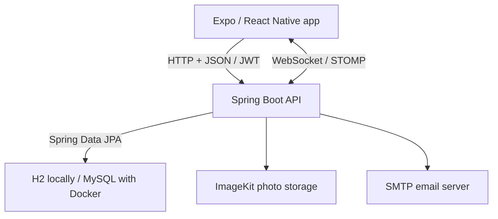

# Restful Housekeeping

Restful Housekeeping is a cross-platform application for coordinating short-term rental cleanings. It gives property managers one place to organize properties, cleaning schedules, reusable checklists, and cleaner assignments, while giving cleaners a focused view of their upcoming work and task details.

This Sheridan College capstone project contains both applications in one repository:

- [Frontend](frontend/) — Expo and React Native mobile app
- [Backend](backend/) — Spring Boot REST API

## Project overview

Managing cleaning operations across multiple short-term rental properties can involve scattered schedules, messages, access instructions, and task lists. Restful Housekeeping brings these details together in a role-based application designed for property managers and cleaners.

Managers can organize properties, schedule cleanings, assign cleaners, and manage their team. Cleaners can view assignments, set weekly availability, follow checklists, upload photos, report issues, and mark cleanings as complete.

## Demo

[](https://youtu.be/d7K5cwK-oac)

## Core features

### Property managers

- View today's and upcoming cleanings from a dashboard
- Create, reschedule, and delete cleanings
- Assign or change a cleaner, or leave a cleaning unassigned
- Manage properties, addresses, access instructions, and property photos
- Create reusable property checklists and add tasks to individual cleanings
- Invite cleaners to an organization and manage team membership
- Import Airbnb calendars to schedule cleanings from reservations
- Review cleaning notes, uploaded photos, and reported issues
- Resolve issues reported by cleaners

### Cleaners

- View assigned and upcoming cleanings
- Read property addresses and cleaning instructions
- Set and edit weekly availability for each day of the week
- Toggle checklist items with changes saved on tap
- Add cleaning notes and upload photos
- Open cleaning photos in a full-screen viewer
- Report issues during a cleaning
- Mark cleanings as complete
- Accept or decline team invitations

### Application capabilities

- Separate manager and cleaner experiences
- Account registration, sign-in, and sign-out
- JWT authentication and secure token storage with Expo SecureStore
- Server-state caching and refresh with TanStack Query
- In-app messaging using WebSockets and STOMP
- ImageKit cloud storage for photos
- Profile editing and profile photo uploads
- Sample data loaded by the local H2 profile
- Interactive API documentation through Swagger UI

## Tech stack

### Frontend

- React 19 and React Native 0.88
- Expo SDK 58
- TypeScript
- React Navigation
- TanStack Query and Axios
- NativeWind and Gluestack UI
- React Hook Form
- Expo SecureStore and Expo Image Picker
- STOMP client for messaging
- Lucide icons

### Backend

- Java 25 and Spring Boot 4
- Spring MVC and Spring Data JPA
- Spring Security and JSON Web Tokens
- Spring WebSocket and Spring Mail
- H2 for local development
- MySQL for Docker and cloud deployment
- ImageKit Java SDK
- ical4j for calendar imports
- Springdoc OpenAPI and Swagger UI
- Maven and Lombok

## Architecture

The frontend uses screens, hooks, and API modules. REST requests carry a JWT from SecureStore, while in-app messaging uses a WebSocket connection. The backend separates request handling, business logic, and database access into controllers, services, and repositories.



## User roles

| Role | Main navigation | Primary responsibilities |
|---|---|---|
| Manager | Dashboard, Properties, Profile | Manage properties, schedules, assignments, checklists, team members, and reported issues |
| Cleaner | Dashboard, Availability, Profile | Review assigned work, set availability, complete tasks, add notes and photos, and report issues |

Authentication determines whether the login screens or the authenticated application is displayed. The user's role controls the available navigation and actions.

## Getting started

### Prerequisites

- Git
- Node.js and npm
- Java 25
- An iOS simulator, Android emulator, or compatible Expo Go installation

The backend includes the Maven Wrapper, so Maven does not need to be installed separately.

### 1. Clone the repository

```bash
git clone https://github.com/sophieynw/capstone.git
cd capstone
```

### 2. Start the backend

From the repository root:

```bash
cd backend
./mvnw spring-boot:run
```

On Windows, use `mvnw.cmd spring-boot:run`.

The API runs at `http://localhost:50000`. Development tools are available at:

- [Swagger UI](http://localhost:50000/swagger-ui/index.html)
- [OpenAPI JSON](http://localhost:50000/v3/api-docs)
- [H2 console](http://localhost:50000/h2-console)

The default H2 profile uses an in-memory database and loads sample organizations, users, properties, checklists, and cleanings. Its data resets whenever the backend restarts.

For the H2 console, use JDBC URL `jdbc:h2:mem:testdb`, username `sa`, and a blank password.

### 3. Configure the frontend connection

Check `API_BASE_URL` in [frontend/api/apiClient.ts](frontend/api/apiClient.ts).

| Platform | API address |
|---|---|
| iOS simulator | `http://127.0.0.1:50000` |
| Android emulator | `http://10.0.2.2:50000` |
| Physical device | `http://<your-computer-lan-ip>:50000` |

For a physical device, replace the matching platform entry (`ios` or `android`) with your computer's LAN address. The device and computer must be on the same network; changing only the `default` entry will not override the iOS or Android entry.

### 4. Install and run the frontend

Open a second terminal from the repository root:

```bash
cd frontend
npm ci
npm start
```

Open the app through the Expo development server. You can also use `npm run ios` or `npm run android` to open a simulator or emulator.

### Demo accounts

The local sample data includes these accounts. Each uses the password `password`.

| Role | Username |
|---|---|
| Manager | `sophie` |
| Cleaner | `robert` |
| Cleaner | `katie` |

### Optional services

- **Photos:** Set `IMAGEKIT_PRIVATE_KEY` before starting the backend to upload photos and view private cleaning photos. On macOS or Linux, run `export IMAGEKIT_PRIVATE_KEY='your-private-key'` in the same terminal before starting Maven. Keep the key out of Git.
- **Email:** The local configuration expects an SMTP server, such as Mailpit, at `localhost:1025`.
- **Docker and MySQL:** See [backend/README.Docker.md](backend/README.Docker.md). Docker Compose exposes the API on port `8080`, so update the frontend API URL to match when using Docker.

## Authentication

| Method | Endpoint | Purpose |
|---|---|---|
| `POST` | `/api/v1/auth/register` | Create a manager or cleaner account |
| `POST` | `/api/v1/auth/authenticate` | Sign in and receive a JWT and user profile |
| `GET` | `/api/v1/auth/username-availability` | Check whether a username is available |

Protected REST requests include the token in the `Authorization` header. The frontend stores it with Expo SecureStore. Managers register with an organization name; cleaners can join an organization through a manager's invitation.

## API areas

The backend provides endpoints for:

- Authentication, organizations, users, and profiles
- Properties and reusable checklists
- Cleanings, assignments, schedules, and completion
- Cleaning checklist items, notes, and photos
- Cleaner availability and availability slots
- Team invitations
- Chat messages
- Airbnb calendar imports
- Issue reporting and resolution

Swagger UI provides the interactive endpoint reference. Authenticate first, then use Swagger's authorization control with the returned JWT to call protected endpoints.

## Project structure

| Path | Contents |
|---|---|
| `frontend/api/` | Axios client and feature-specific API requests |
| `frontend/auth/` | Authentication context and token storage |
| `frontend/components/` | Reusable feature and UI components |
| `frontend/hooks/` | TanStack Query hooks |
| `frontend/screens/` | Shared, manager, and cleaner screens |
| `frontend/styles/`, `frontend/types/`, `frontend/utils/` | Shared styles, types, and helpers |
| `frontend/App.tsx`, `frontend/Navigation.tsx` | Application providers and navigation |
| `backend/src/main/java/ca/sheridancollege/restfulhousekeeping/` | Backend source code |
| `backend/src/main/resources/` | Application configuration and database profiles |
| `backend/src/test/` | Backend tests |
| `backend/pom.xml` | Maven dependencies and build configuration |
| `backend/compose.yaml` | Local Docker and MySQL services |

The backend source is organized into `beans`, `bootstrap`, `config`, `controllers`, `models`, `repositories`, and `services`.

## Current development status

The project includes the core property and cleaning workflows, saved availability, checklist updates, notes, photo uploads, team invitations, messaging, issue reporting, and Airbnb calendar imports.

Password recovery is still marked as coming soon. The frontend does not currently define an automated test script.

## Tests

Run the backend test suite from the repository root:

```bash
cd backend
./mvnw test
```

On Windows, use `mvnw.cmd test`.

## Contributors

- Sophie Wang
- Robert Fleming
- Sunggyu Kang
- Alex Tumanan

## License

No license is currently specified for this project.
